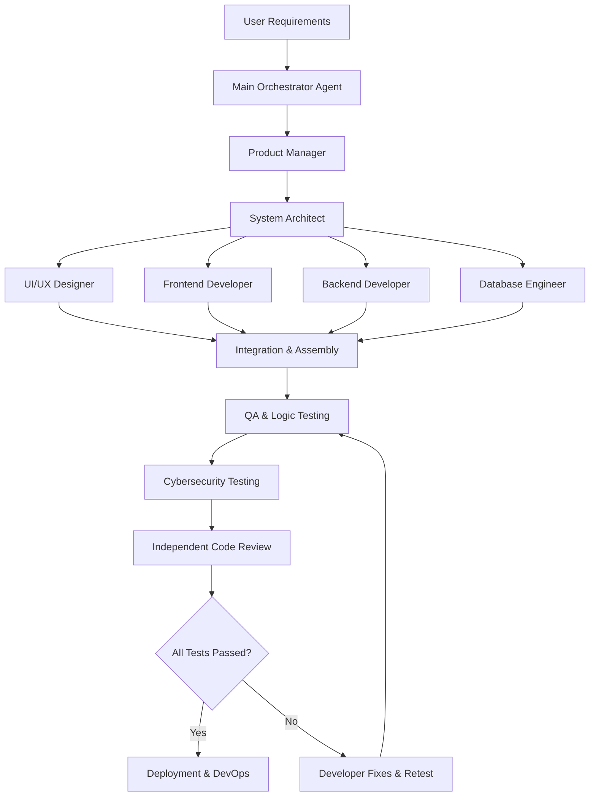

# AI Software Development Team: Roles & Operational Specifications

This document defines the 12-agent hierarchy, roles, responsibilities, and operating standards for the ZetaSports / KeralaHub development and design stabilization initiative.

---

## Agent Hierarchy & Roles

---

## Agent Roster & Assigned Responsibilities

| # | Agent Name | Priority | Core Responsibilities | Deliverables |
| :- | :--- | :--- | :--- | :--- |
| **1** | **Main Orchestrator** | Essential | Coordinates all agents, maintains central task board, resolves conflicts, enforces standards. | Task board, progress logs, release sign-off. |
| **2** | **Product Manager** | Essential | Requirements analysis, user stories, feature prioritization (MoSCoW), acceptance criteria. | `docs/PRD.md`, `agent-reports/product-manager.md`. |
| **3** | **System Architect** | Essential | Technical structure, component boundaries, CDN strategy, integration standards. | `docs/ARCHITECTURE.md`, `agent-reports/architect.md`. |
| **4** | **UI/UX Designer** | Essential | Design system, typography, color harmony, layout visual consistency, anti-collision design. | `docs/DESIGN_SYSTEM.md`, `agent-reports/designer.md`. |
| **5** | **Frontend Developer** | Essential | Reusable UI components, Blogger XML template implementation, responsive layouts, routing. | XML theme updates, JS modules, `agent-reports/frontend.md`. |
| **6** | **Backend Developer** | Essential | Supabase Edge Functions, REST endpoints, proxy gateways, streaming playlist parsing. | API endpoints, backend logic, `agent-reports/backend.md`. |
| **7** | **Database Engineer** | Essential | Database schema, foreign keys, RLS security policies, query optimization. | `docs/DATABASE_SCHEMA.md`, `agent-reports/database.md`. |
| **8** | **QA Engineer** | Essential | Functional testing, cross-browser verification, regression testing, bug reporting. | Test suites, execution reports, `agent-reports/qa.md`. |
| **9** | **Logic & Edge Case Tester** | Essential | State transitions, race conditions, null/empty edge cases, unexpected user journeys. | Edge case test matrix, `agent-reports/logic-tester.md`. |
| **10** | **Cybersecurity Engineer** | Essential | OWASP Top 10 compliance, token sanitization, XSS/HTML escaping, iframe sandboxing. | `docs/SECURITY_REQUIREMENTS.md`, `agent-reports/security.md`. |
| **11** | **Code Reviewer** | Essential | Independent inspection of code changes, maintainability, architectural adherence. | Code review audit, `agent-reports/code-review.md`. |
| **12** | **Deployment & DevOps** | Essential | Supabase Storage CDN deployment, GitHub syncing, release health monitoring. | CDN deployment scripts, `agent-reports/deployment.md`. |

---

## Operating Protocol & Quality Gates

1. **Evidence-Based Completion**: No agent may mark a task complete without empirical test logs, diffs, or screenshots.
2. **Cybersecurity First**: Zero credential leaks, mandatory HTML escaping (`escapeHtml`), strict URL sanitization (`sanitizeUrl`), and safe sandboxing for all embed iframes.
3. **Single File CSS SOT (Source of Truth)**: All custom styling is centralized in `web/css/zetasports-core.css` and hosted on Supabase Storage CDN to prevent template bloat and duplication.
4. **Byte Mirror Parity**: `zetasports-colorify-blogger-theme.xml` and `zetasports-v3/web/colorify_zetasports_theme.xml` must remain 100% byte-identical at all times.

