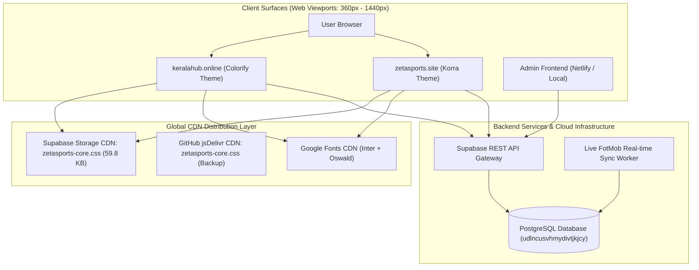

# Technical Architecture Document

**System:** ZetaSports Enterprise Cross-Surface Architecture  
**Author:** Senior Software Architect  
**Version:** 3.6.0  

---

## 1. System Topology & Dual-Blogger Model



---

## 2. Cross-Domain Routing Engine

The client-side routing architecture routes seamlessly across both domains:

1. **Match Discovery**:
   - Both `keralahub.online` and `zetasports.site` load match cards dynamically from Supabase `matches` table.
   - Clicking a match card navigates to `https://www.keralahub.online/{team1}-vs-{team2}-{matchId}`.
2. **Match Center & 404 Interception**:
   - When Blogger serves a 404 error page for custom slugs, the client-side JavaScript router intercepts the path.
   - Extracts `matchId` via regex `/[a-f0-9-]{36}/i`.
   - Hides `#homeView` and displays `#matchView`.
   - Queries Supabase for lineups, timeline, statistics, and H2H records.
3. **Stream Gateway Routing**:
   - Clicking "Watch Live Stream" on KeralaHub directs the user to:
     `http://www.zetasports.site/?stream={matchId}`.
   - ZetaSports activates `#streamView`, resolves the best streaming server from `stream_servers` table, and embeds the sanitized player iframe.

---

## 3. Decoupled CSS Architecture (Source of Truth)

To eliminate over 6,500 lines of template bloat and prevent design divergences:
- All custom CSS is compiled into `web/css/zetasports-core.css`.
- Uploaded directly to Supabase Storage public bucket (`scripts/zetasports-core.css`).
- Imported in the `<head>` of both themes:
  ```html
  <link rel="stylesheet" href="https://udlncusvhmydivtjkjcy.supabase.co/storage/v1/object/public/scripts/zetasports-core.css" id="zetasports-core-css"/>
  ```
- **Architectural Advantage**: Any CSS adjustments made to fonts, layout, or mobile scaling propagate across all live websites instantly without touching Blogger XML templates.
