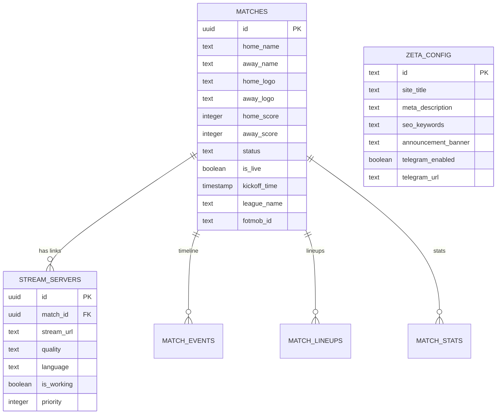

# Database Schema & Data Architecture

**Database:** Supabase PostgreSQL (`udlncusvhmydivtjkjcy.supabase.co`)  
**Author:** Senior Database Engineer  
**Version:** 3.6.0  

---

## 1. Core Tables & Entity Relationships

---

## 2. Table Specifications

### 1. `matches`
Stores all today, live, and upcoming fixtures synchronized from FotMob and live data crawlers.
- Primary Key: `id` (UUID)
- Key Indexes:
  - `idx_matches_kickoff` ON `matches (kickoff_time DESC)`
  - `idx_matches_is_live` ON `matches (is_live)` WHERE `is_live = true`
  - `idx_matches_fotmob` ON `matches (fotmob_id)`

### 2. `stream_servers`
Stores verified live stream broadcast links for the streaming gateway.
- Foreign Key: `match_id` REFERENCES `matches(id) ON DELETE CASCADE`
- Security Constraints: URLs must match sanitized streaming patterns (`http://`, `https://`).

### 3. `zeta_config`
Centralized application settings, announcement banners, and SEO metadata:
- `id`: Primary key (e.g. `'global'`)
- `site_title`: Dynamic browser `<title>`
- `meta_description`: Live meta description
- `seo_keywords`: Comma-separated target keywords
- `announcement_banner`: Broadcast message banner
- `telegram_enabled`: Boolean flag for popup channel invitations

---

## 3. Row Level Security (RLS) Policies

All tables enforce strict Row Level Security:
- `matches`: Public read (`SELECT`) allowed for all anon users. Write (`INSERT`, `UPDATE`, `DELETE`) restricted to `service_role` and authenticated admin.
- `stream_servers`: Public read (`SELECT`) allowed for working streams. Write restricted to `service_role`.
- `zeta_config`: Public read (`SELECT`) allowed for all anon users. Write restricted to `service_role`.
- `storage.objects`: Public read (`SELECT`) on `scripts` and `match-thumbnails` buckets. Write restricted to `service_role`.
